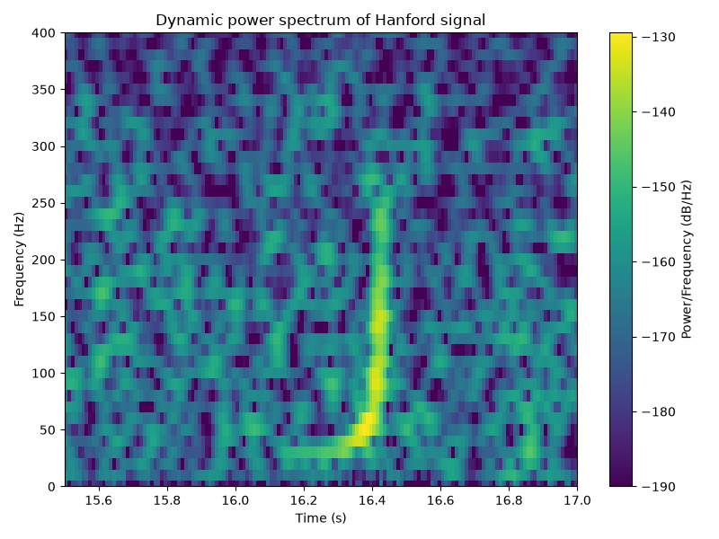
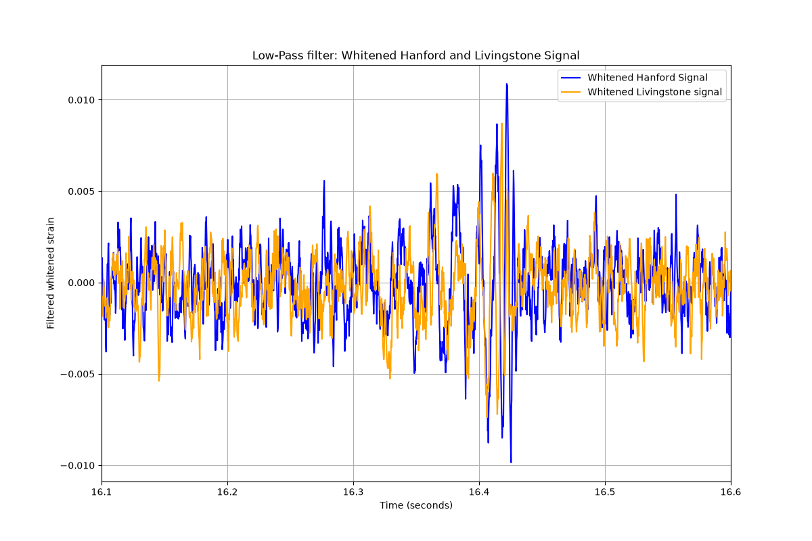

# Detecting Gravitational Waves in LIGO Data (GW150914)

Signal-processing pipeline that recovers the **first directly detected gravitational wave** (14 September 2015) from the raw strain data of the two LIGO detectors in Hanford (H1) and Livingston (L1). The pipeline uses window functions, power-spectrum analysis, spectral whitening, FIR low-pass filtering, time-delay estimation between the detectors and a time–frequency analysis.

📄 **Report:** [`report/LIGO_signal_processing_report.pdf`](report/LIGO_signal_processing_report.pdf)

<p align="center">
  
  
</p>

*Left: dynamic power spectrum of the whitened Hanford signal. The characteristic "chirp", rising from about 35 Hz to about 250 Hz at t ≈ 16.4 s, is the inspiral and merger of two black holes. Right: whitened and low-pass filtered strain from both detectors around the event.*

## Pipeline

| Step | Script | What it does |
|---|---|---|
| 1–2 | `task1_2_load_and_plot.py` | Read the HDF5 strain files (131,072 samples, f<sub>s</sub> = 4096 Hz, 32 s) |
| 3 | `task3_window_functions.py`, `task3g_hann_vs_hamming.py` | Spectral leakage on a test signal with a 10⁻⁵ amplitude ratio. Rectangular, Hann and Hamming windows compared. The Hann window is chosen because it is the only one that resolves the weak tone |
| 4 | `task4_power_spectrum.py` | Hann-windowed power spectrum (dB) of both detectors, with identification of the strong instrumental lines |
| 5 | `task5_whitening.py` | **Whitening** in the frequency domain (ĥ[k] = 1/\|x̂[k]\|) followed by an inverse FFT. The event appears at t ≈ 16.2–16.5 s |
| 6 | `task6_lowpass_filter.py` | Running-mean FIR low-pass filter (L = 8, −6 dB near 300 Hz) with group-delay compensation, τ = (L−1)/(2f<sub>s</sub>) = 0.85 ms |
| 7 | `task7_time_delay.py` | **Arrival-time difference** between the detectors: n₀ = 19 samples → **Δt ≈ 4.6 ms**. This is below the ~10 ms light travel time between the sites, which is consistent with a wave propagating at the speed of light |
| 8 | `task8_spectrogram.py` | Dynamic power spectrum (spectrogram) that reveals the chirp |

## Running

```bash
pip install -r requirements.txt
python src/task5_whitening.py       # any script, run from the repository root
```

The figures are written to `figures/`.

## Data

The strain data (`data/*.hdf5`, 32 s around GW150914 at 4 kHz) comes from the [Gravitational Wave Open Science Center (GWOSC)](https://gwosc.org), released under CC BY 4.0.
> LIGO Scientific Collaboration and Virgo Collaboration, *Observation of Gravitational Waves from a Binary Black Hole Merger*, Phys. Rev. Lett. 116, 061102 (2016).

---
*Programming assignment in FYS-2006 – Signal Processing, UiT The Arctic University of Norway (autumn 2024).*
